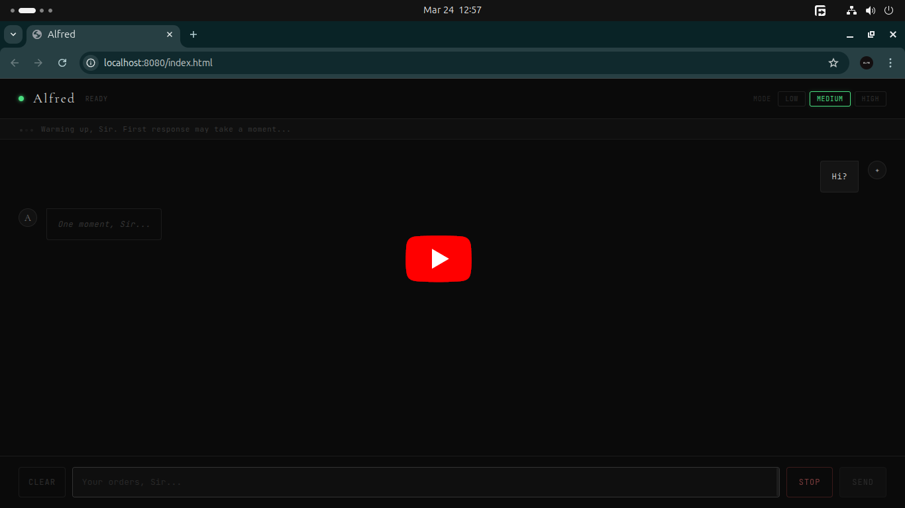
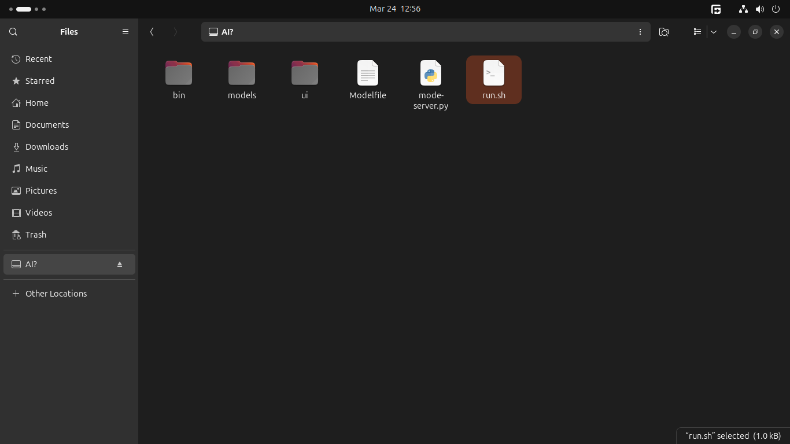
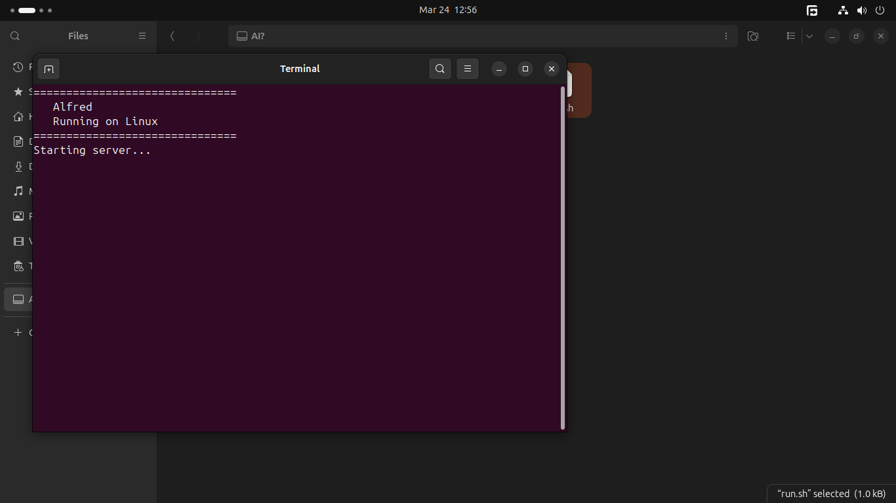
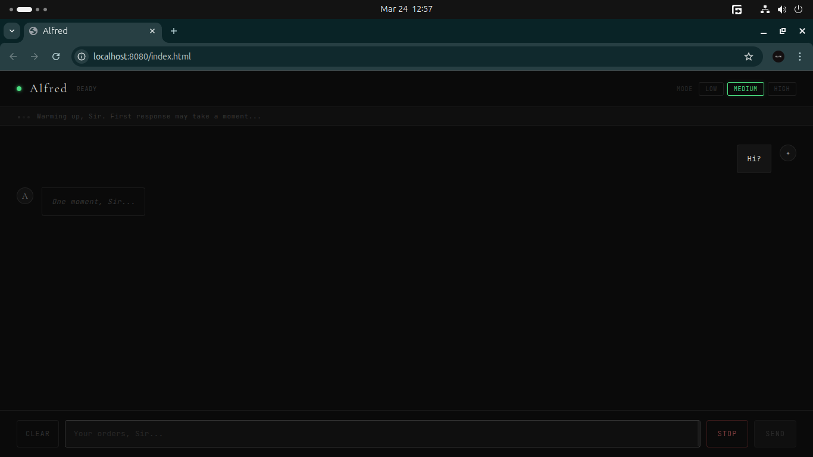
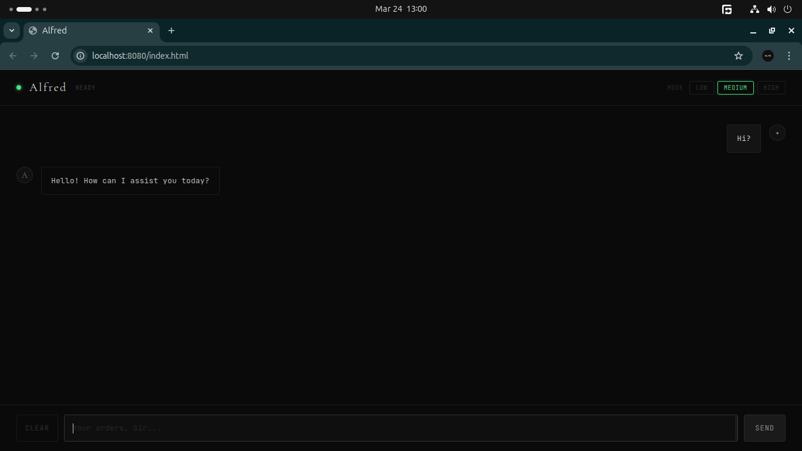
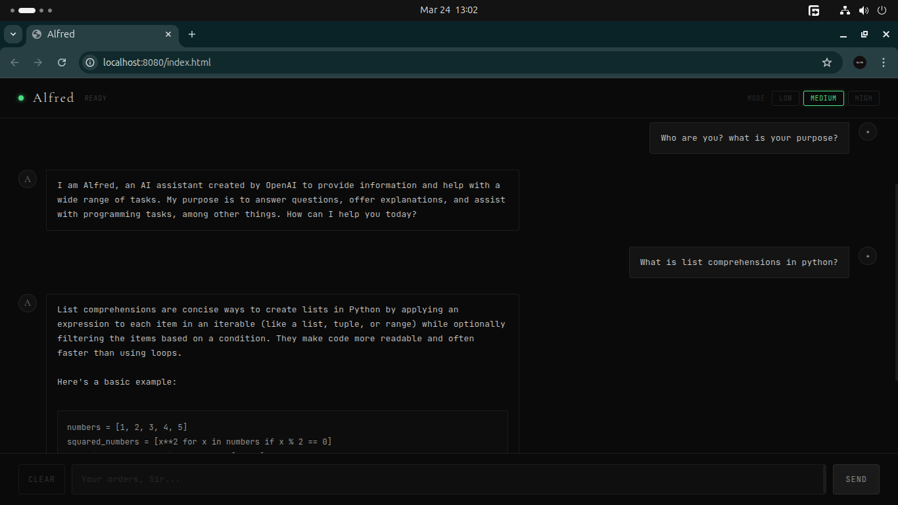

# Alfred: the usb butler

A portable, local AI assistant that runs directly from a USB drive.

Designed to adapt across different hardware using performance modes.

 *Your personal, offline “butler AI”.*

---

## Concept

Alfred is built to be:

- **Portable** → runs from a USB drive  
- **Local-first** → no internet required  
- **Adaptive** → adjusts performance based on system specs  
- **Assistant-like** → helps with general and coding tasks using an LLM  

---

## Demo

[](https://your-youtube-link-here)

> Click to watch a quick preview of Alfred in action

---

## Preview

| Start-up:Preview 1 | Preview 2 |
|-----------|-----------|
|  |  |

| Use-case:Preview 1 | Preview 2 | Preview 3 |
|-----------|-----------|-----------|
|  |  |  |
---

## Features

- Local LLM (Qwen 3B)
- Runs entirely from USB
- Multiple performance modes (based on device capability)
- Modular structure (UI + backend separation)
- Works across different system configurations
- Lightweight and customizable

---

## Project Structure
```bash
Alfred_USB_AI/
│
├── bin/ # Executables / runtime files
├── models/ # Model storage (excluded from repo)
├── ui/ # Interface components
│
├── Modelfile # Model configuration
├── mode-server.py # Core logic for mode selection & serving
├── run.sh # Startup script
```


---

## How It Works

1. User plugs in USB  
2. Runs `run.sh`  
3. Alfred is ready to assist
---

## Usage

```bash
cd <folder-path>
chmod +x run.sh
./run.sh
```

## Notes

- Model files (Qwen 3B) are not included due to size
- Place your model inside the `/models` directory before running Alfred
- Performance depends on system hardware
- First response might take time if not running on GPU

## Things learned

- Running LLMs locally with constrained resources
- Designing adaptive systems for different hardware tiers
- Structuring portable environments (USB-based execution)
- Separating UI and backend logic cleanly
- Managing model configurations and runtime scripts

## Philosophy

A personal AI should be private, portable, and always available — not locked behind servers